# Network Security Lab : Segmentation réseau, VPN IPsec et IDS/IPS avec pfSense

Laboratoire de sécurité réseau déployé sous VirtualBox : segmentation en trois zones (LAN, DMZ, GUEST) filtrées par un pare-feu pfSense, tunnel VPN IPsec site-to-site entre deux sites simulés, et détection/blocage d'un scan Nmap avec Suricata en mode IPS.

## Table des matières

1. [Présentation](#présentation)
2. [Objectifs](#objectifs)
3. [Technologies utilisées](#technologies-utilisées)
4. [Architecture](#architecture)
5. [Prérequis](#prérequis)
6. [Déroulement du projet](#déroulement-du-projet)
7. [Résultats](#résultats)
8. [Remarques et limites](#remarques-et-limites)
9. [Structure du dépôt](#structure-du-dépôt)
10. [Auteur](#auteur)

---

## Présentation

Ce projet reproduit l'infrastructure réseau d'une entreprise multi-sites et en valide la sécurité par des tests concrets.

Le **site A** est protégé par un pare-feu **pfSense-A** à quatre interfaces (WAN, LAN, DMZ, GUEST). Les règles de filtrage appliquent le principe du moindre privilège : le réseau invité ne peut pas atteindre le LAN ni la DMZ, et la DMZ ne peut pas atteindre le LAN. Le **site B**, protégé par **pfSense-B**, est relié au site A par un tunnel **IPsec** (IKEv2). Enfin, **Suricata** est déployé sur l'interface DMZ de pfSense-A en mode Block Offenders : un scan **Nmap** lancé depuis une machine **Kali Linux** génère des alertes et l'hôte attaquant est bloqué automatiquement.

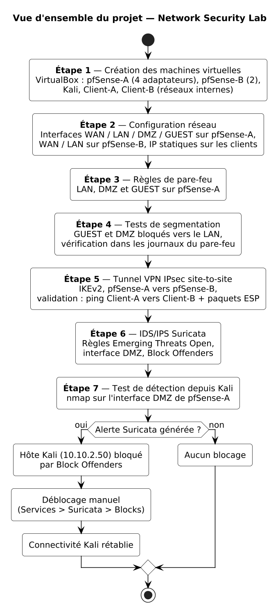

> **Avertissement.** Ce laboratoire est réalisé dans un environnement isolé, composé de réseaux internes VirtualBox. Les tests d'attaque sont réalisés uniquement contre les machines du laboratoire.

---

## Objectifs

- Construire une architecture réseau segmentée en trois zones : LAN (postes internes), DMZ et GUEST (invités).
- Filtrer les flux inter-zones avec pfSense selon le principe du moindre privilège.
- Relier deux sites simulés par un tunnel VPN IPsec site-to-site et vérifier que le trafic est chiffré (ESP).
- Déployer Suricata sur l'interface DMZ pour détecter et bloquer automatiquement une reconnaissance réseau.
- Valider chaque étape par des tests et par l'analyse des journaux du pare-feu et de Suricata.

---

## Technologies utilisées

| Catégorie | Technologie |
|---|---|
| Virtualisation | Oracle VirtualBox (réseaux internes) |
| Pare-feu / routeur | pfSense CE 2.7.2 (pfSense-A et pfSense-B) |
| VPN | IPsec site-to-site, IKEv2, ESP (AES-256, SHA256) |
| IDS/IPS | Suricata (package pfSense), règles Emerging Threats Open |
| Machine attaquante | Kali Linux, Nmap 7.99 |
| Postes clients | Ubuntu (Client-A) |

---

## Architecture

### Architecture réseau du laboratoire

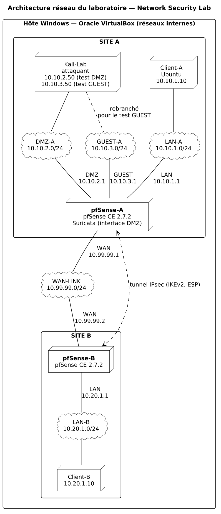

### Plan d'adressage

| Machine | Réseau interne VirtualBox | Adresse IP | Rôle |
|---|---|---|---|
| pfSense-A (WAN) | WAN-LINK | 10.99.99.1 | Lien vers le site B |
| pfSense-A (LAN) | LAN-A | 10.10.1.1 | Passerelle du LAN |
| pfSense-A (DMZ) | DMZ-A | 10.10.2.1 | Passerelle de la DMZ |
| pfSense-A (GUEST) | GUEST-A | 10.10.3.1 | Passerelle du réseau invité |
| pfSense-B (WAN) | WAN-LINK | 10.99.99.2 | Lien vers le site A |
| pfSense-B (LAN) | LAN-B | 10.20.1.1 | Passerelle du LAN du site B |
| Client-A | LAN-A | 10.10.1.10 | Poste interne du site A |
| Client-B | LAN-B | 10.20.1.10 | Poste interne du site B |
| Kali-Lab | DMZ-A ou GUEST-A | 10.10.2.50 / 10.10.3.50 | Machine attaquante (rebranchée selon le test) |

### Politique de filtrage inter-zones

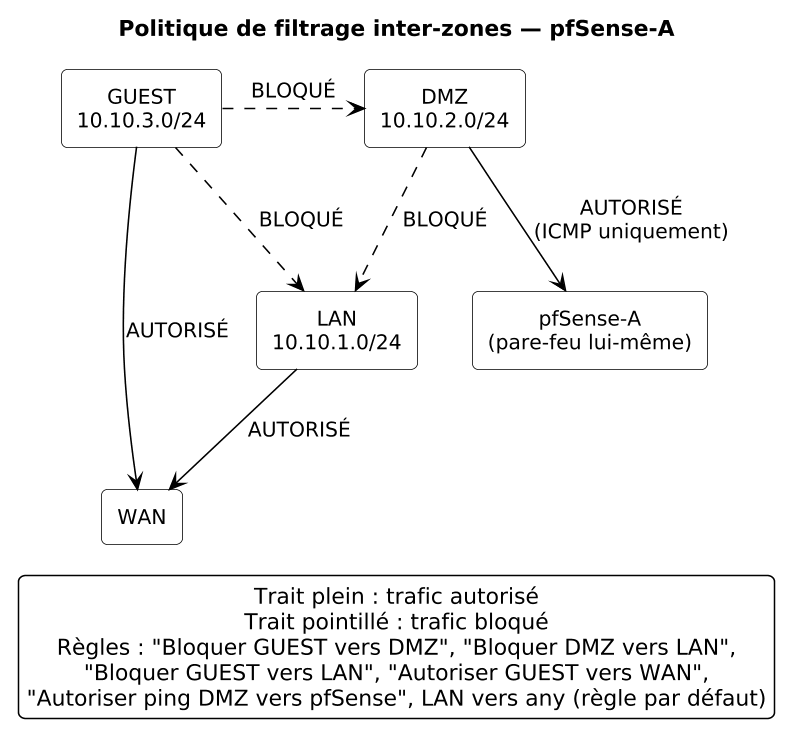

---

## Prérequis

- Oracle VirtualBox
- Image ISO de pfSense CE 2.7.2 (amd64)
- Image de Kali Linux
- Deux machines Ubuntu pour les clients de test

---

## Déroulement du projet

### Étape 1 : Création des machines virtuelles et configuration réseau

pfSense-A est configuré avec quatre adaptateurs réseau de type Réseau interne : `WAN-LINK`, `LAN-A`, `DMZ-A` et `GUEST-A`. pfSense-B utilise deux adaptateurs (`WAN-LINK` et `LAN-B`).

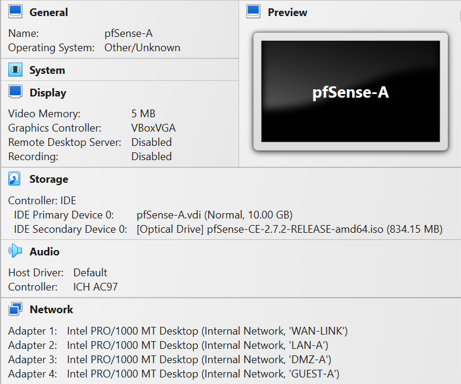

Client-A est configuré en IP statique (`10.10.1.10/24`, passerelle `10.10.1.1`) et joint la passerelle pfSense-A sans perte de paquets.

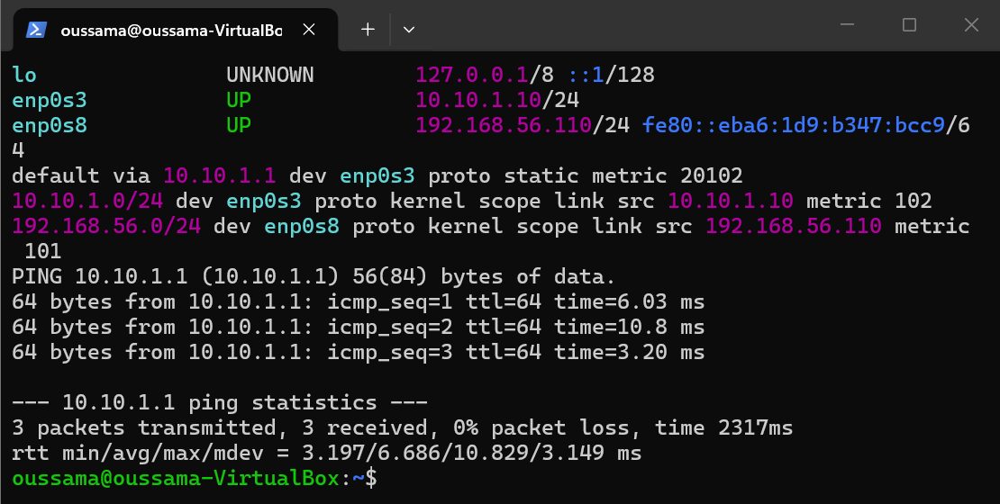

Les tableaux de bord confirment les interfaces actives de pfSense-A (WAN, LAN, DMZ, GUEST) et de pfSense-B (WAN, LAN), toutes deux en version 2.7.2.

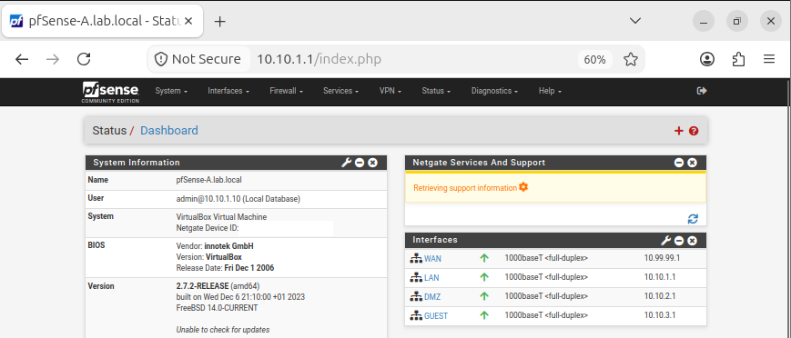

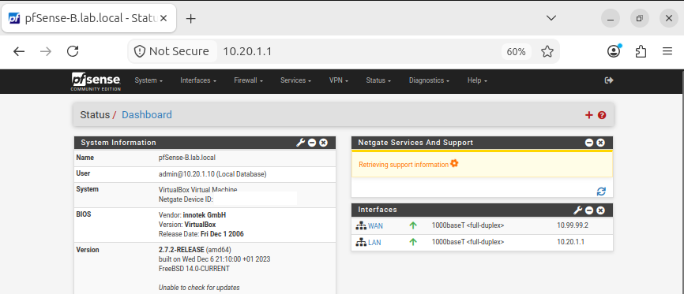

Le lien WAN entre les deux pare-feux est validé par un ping depuis pfSense-A (source WAN) vers `10.99.99.2`.

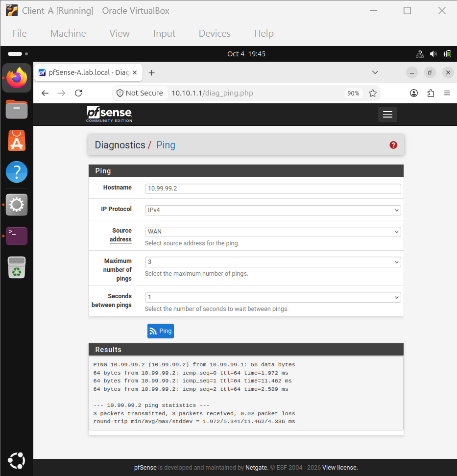

### Étape 2 : Règles de pare-feu

| Zone | Règle | Action |
|---|---|---|
| LAN | Anti-Lockout et règles par défaut (LAN vers any, IPv4 et IPv6) | Autoriser |
| DMZ | « Bloquer DMZ vers LAN » | Bloquer |
| DMZ | « Autoriser ping DMZ vers pfSense » (ICMP vers le pare-feu) | Autoriser |
| GUEST | « Bloquer GUEST vers LAN » | Bloquer |
| GUEST | « Bloquer GUEST vers DMZ » | Bloquer |
| GUEST | « Autoriser GUEST vers WAN » | Autoriser |
| IPsec | « Autoriser trafic VPN » | Autoriser |

Les règles de blocage sont placées avant la règle d'autorisation sur l'onglet GUEST.

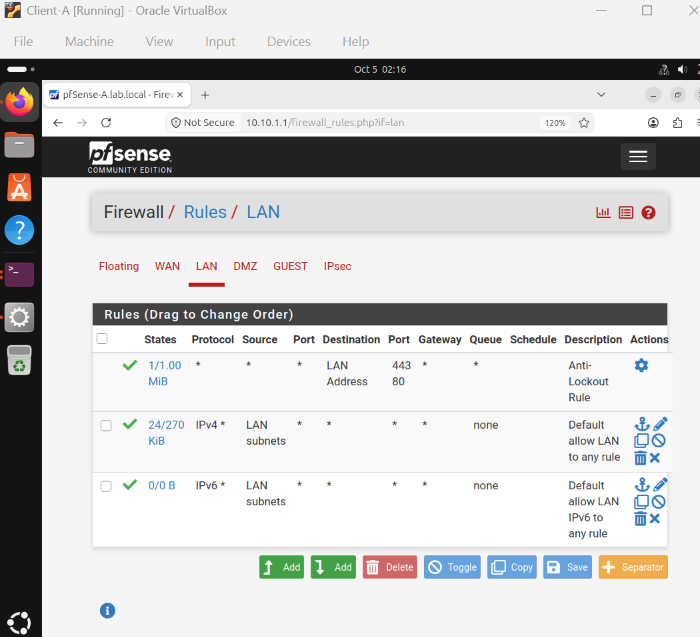

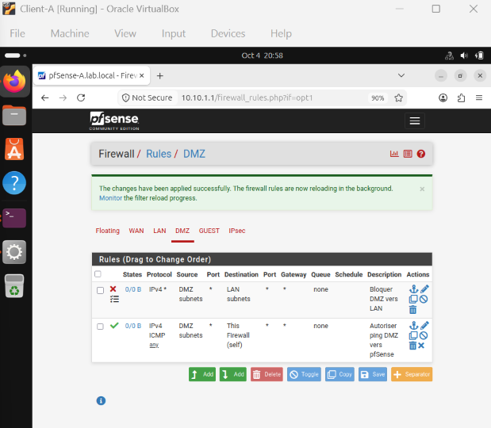

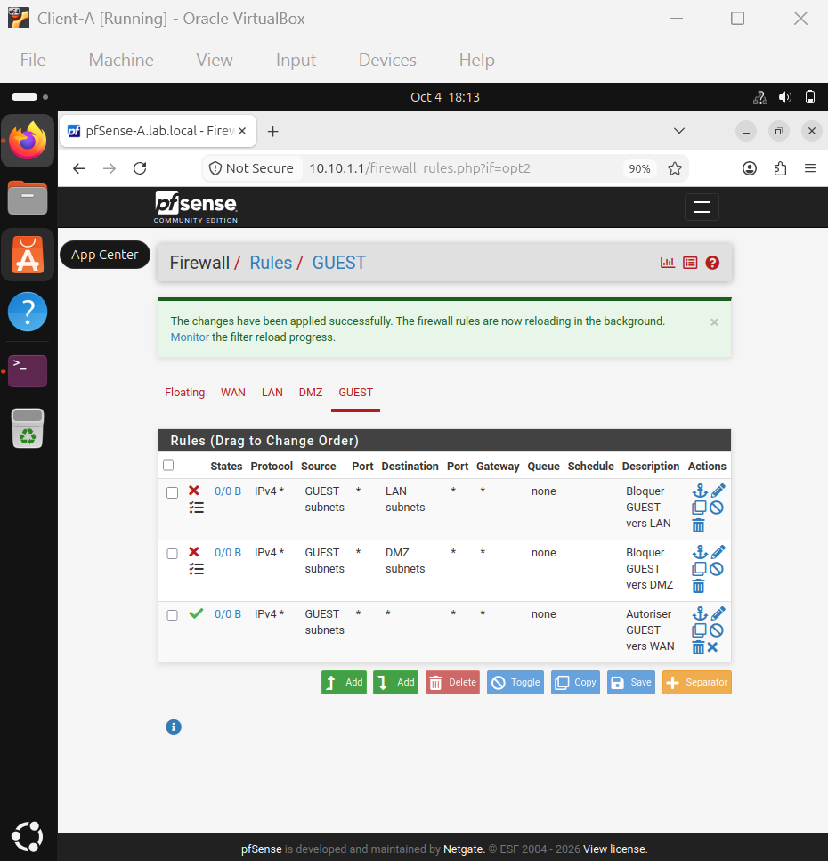

### Étape 3 : Tests de segmentation

**Depuis la zone GUEST.** Kali est configurée sur le réseau invité :

```bash
sudo ip addr flush dev eth0
sudo ip addr add 10.10.3.50/24 dev eth0
sudo ip link set eth0 up
sudo ip route add default via 10.10.3.1
```

La passerelle `10.10.3.1` répond, alors que le ping vers le LAN (`10.10.1.10`) et vers la DMZ (`10.10.2.1`) échoue avec 100 % de perte.

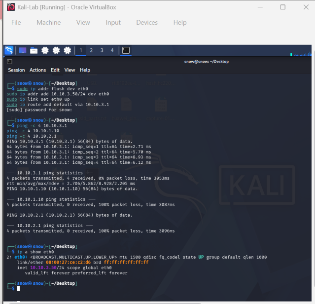

Les journaux du pare-feu montrent les blocages volontaires, associés aux règles « Bloquer GUEST vers LAN » et « Bloquer GUEST vers DMZ ». Ils prouvent que l'échec des pings résulte du filtrage et non d'une panne.

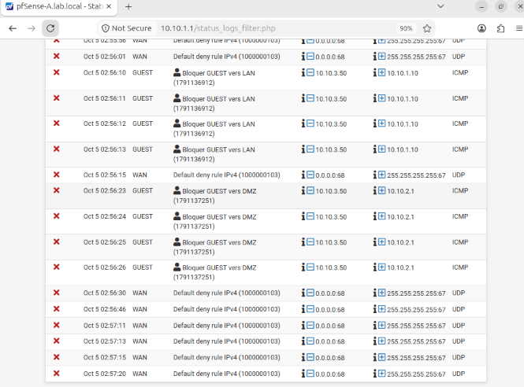

**Depuis la DMZ.** Kali est rebranchée sur la DMZ (`10.10.2.50/24`). La passerelle DMZ répond, tandis que le ping vers le LAN (`10.10.1.10`) est bloqué.

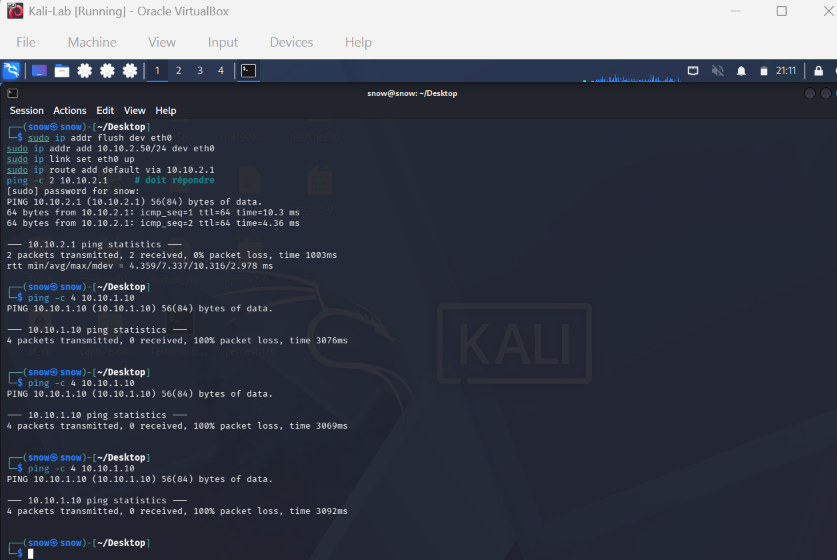

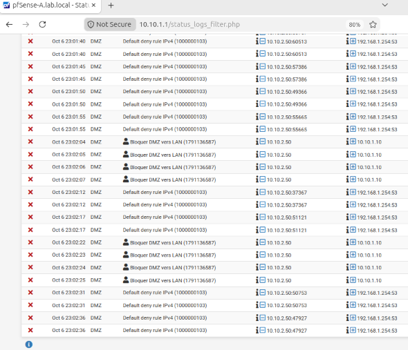

**Depuis le LAN.** Client-A joint la passerelle DMZ (`10.10.2.1`) sans perte de paquets.

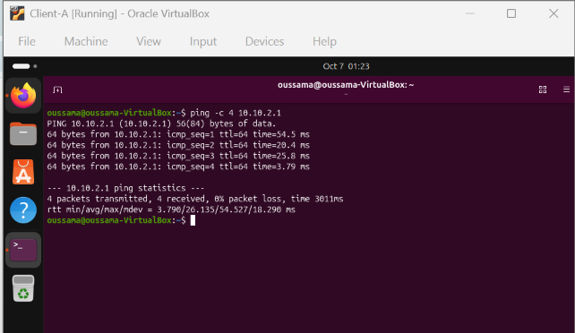

### Étape 4 : Tunnel VPN IPsec site-to-site

Le tunnel est configuré en miroir sur les deux pare-feux. La clé pré-partagée n'est pas publiée dans ce dépôt.

| Paramètre | Valeur |
|---|---|
| Version IKE | IKEv2 |
| Authentification | Mutual PSK |
| Phase 1 | AES 256, SHA256, groupe DH 14 (2048 bits) |
| Phase 2 | Mode tunnel, protocole ESP, AES 256, SHA256 |
| Réseau local / distant (pfSense-A) | 10.10.1.0/24 / 10.20.1.0/24 |
| Réseau local / distant (pfSense-B) | 10.20.1.0/24 / 10.10.1.0/24 |
| Passerelle distante | 10.99.99.2 (vue depuis A) / 10.99.99.1 (vue depuis B) |

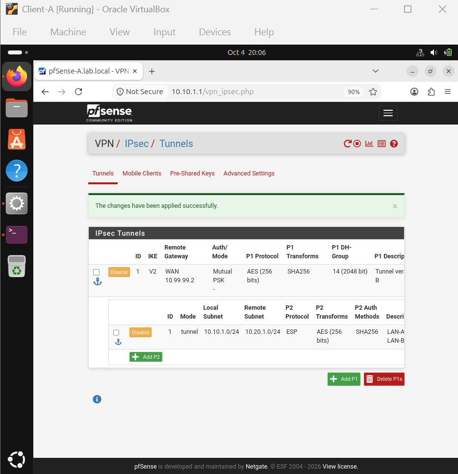

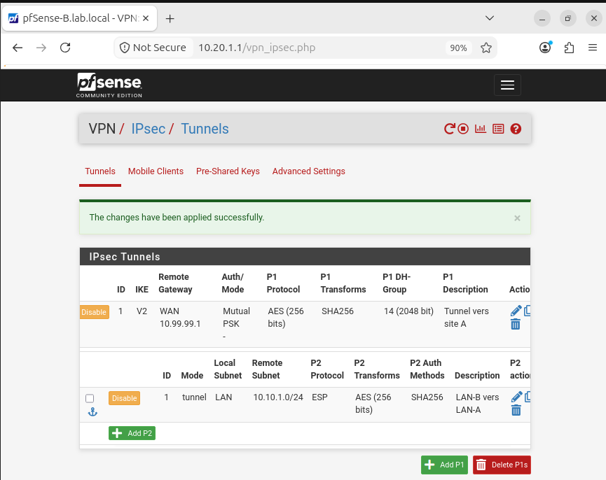

Une règle autorisant le trafic VPN est ajoutée sur l'onglet IPsec.

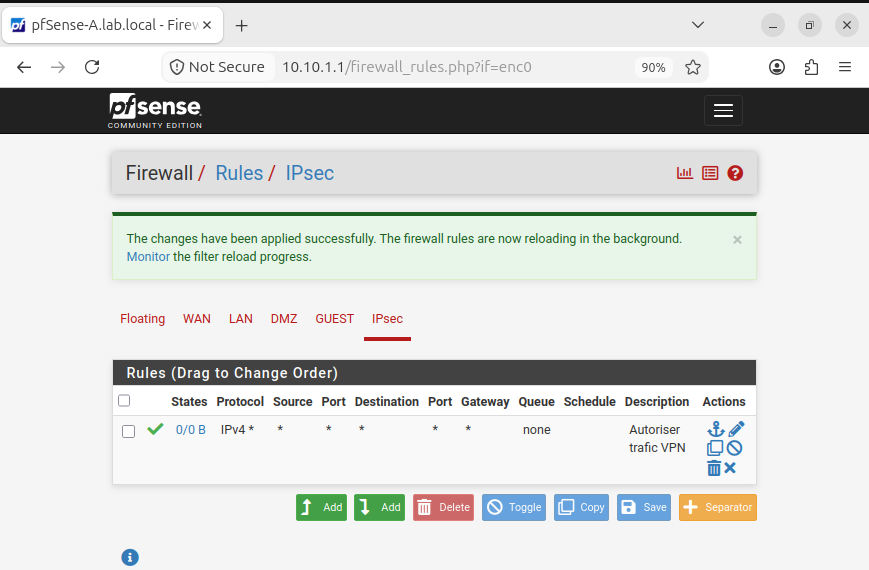

La page *Status > IPsec* indique que la SA de phase 1 est **Established** et que la SA de phase 2 est installée (compteurs de paquets entrants et sortants).

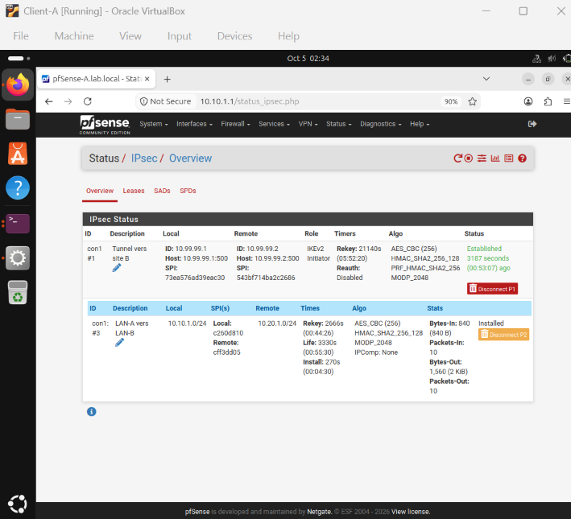

Client-A joint Client-B (`10.20.1.10`) à travers le tunnel, sans perte de paquets.

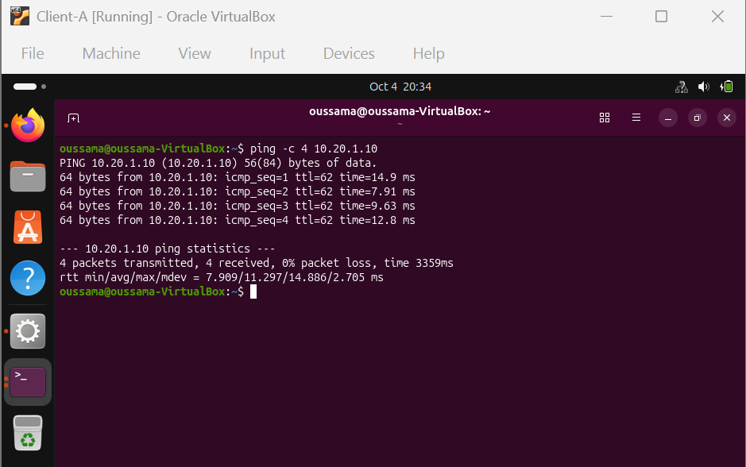

La capture de paquets réalisée sur l'interface `em0` (WAN) de pfSense-A montre des paquets **ESP** échangés entre `10.99.99.1` et `10.99.99.2` : le trafic entre les deux sites est encapsulé et chiffré.

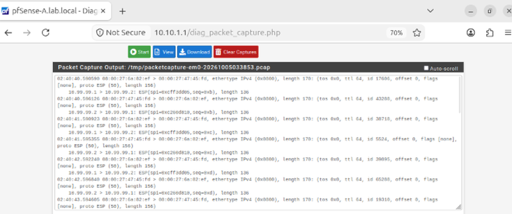

Déroulement de l'établissement du tunnel et du trafic chiffré :

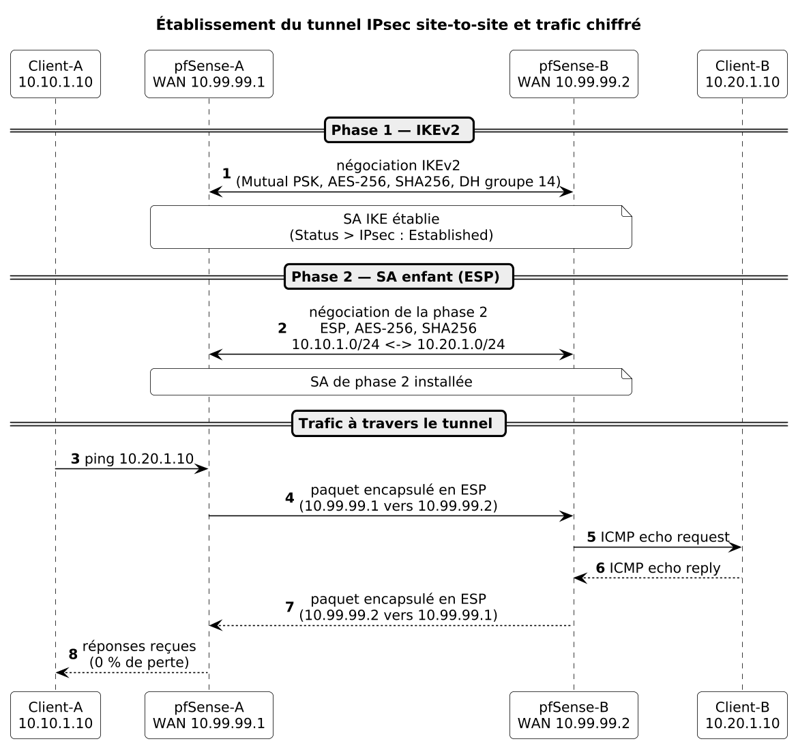

### Étape 5 : IDS/IPS Suricata

Suricata est installé sur pfSense-A. Le jeu de règles **Emerging Threats Open** est téléchargé (mise à jour réussie), les autres jeux de règles proposés restent désactivés.

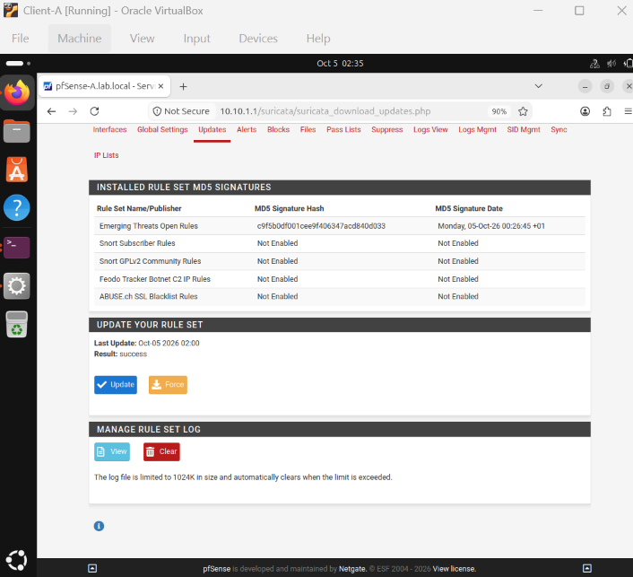

L'interface DMZ est configurée avec l'option **Block Offenders** (blocage automatique de l'hôte à l'origine d'une alerte), le mode IPS **Legacy Mode**, l'option **Kill States** et le blocage de l'adresse source (`SRC`).

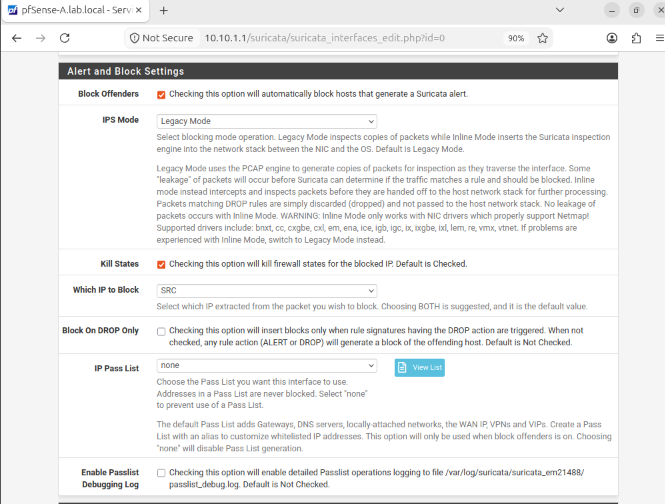

Le moteur est démarré sur l'interface DMZ (`em2`).

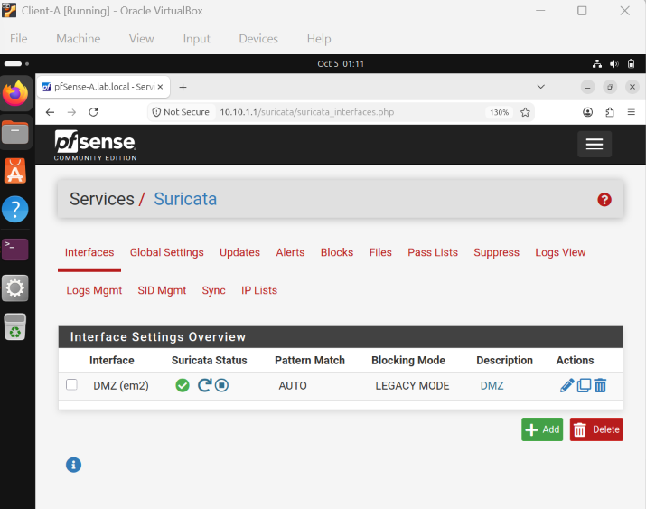

### Étape 6 : Test de détection et de blocage

Kali est placée sur la DMZ (`10.10.2.50/24`) et joint la passerelle avant le scan.

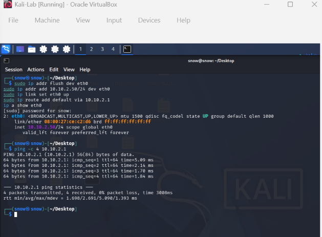

Un scan Nmap est lancé contre l'interface DMZ de pfSense-A :

```bash
nmap -n -sS -A 10.10.2.1
```

Après le scan, le ping vers `10.10.2.1` n'obtient plus aucune réponse (100 % de perte) : Kali est bloquée.

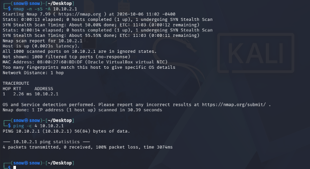

Suricata a généré des alertes sur l'instance DMZ, avec pour source `10.10.2.50` (Kali) et pour destination `10.10.2.1` : `SURICATA ICMPv4 unknown code` (GID:SID `1:2200025`).

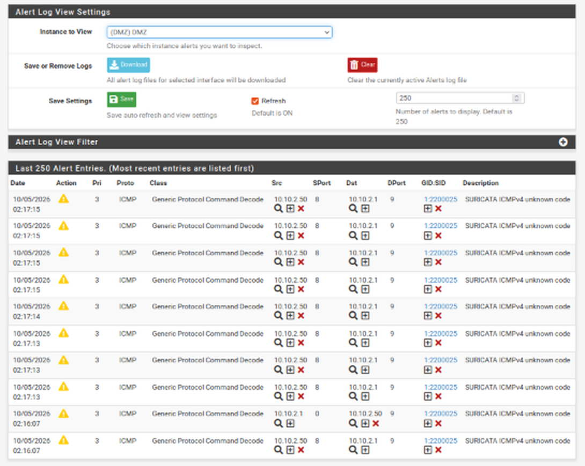

L'onglet *Blocks* confirme que l'hôte `10.10.2.50` est bloqué par Suricata.

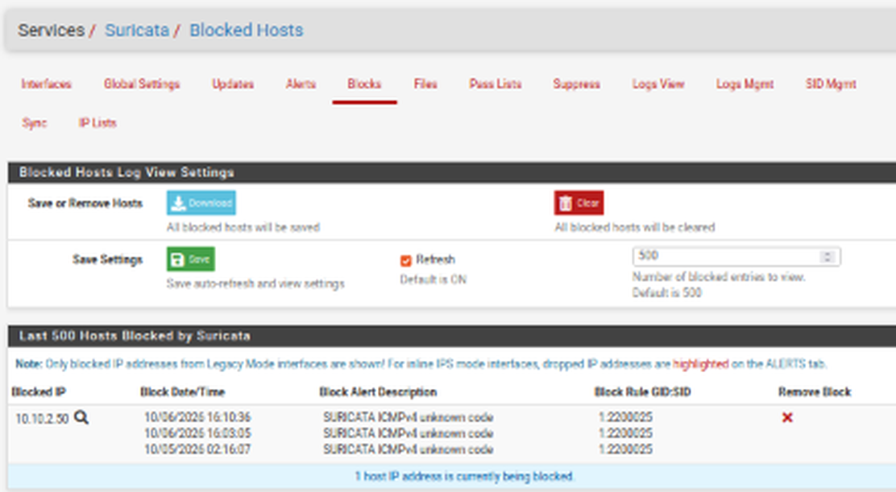

Après suppression du blocage dans *Services > Suricata > Blocks*, la connectivité de Kali est rétablie.

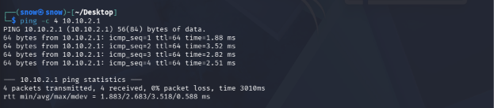

Déroulement du test de détection :

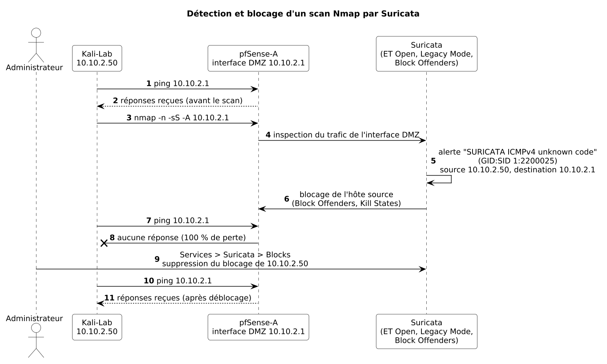

---

## Résultats

- **Segmentation validée :** depuis GUEST, le LAN et la DMZ sont injoignables (100 % de perte) ; depuis la DMZ, le LAN est injoignable. Les blocages sont tracés dans les journaux du pare-feu (règles « Bloquer GUEST vers LAN », « Bloquer GUEST vers DMZ » et « Bloquer DMZ vers LAN »).
- **Flux autorisés vérifiés :** Client-A (LAN) joint la passerelle DMZ ; Kali joint la passerelle de sa zone (GUEST ou DMZ).
- **Tunnel IPsec opérationnel :** phase 1 IKEv2 *Established*, ping Client-A vers Client-B réussi (4 paquets sur 4), trafic observé en **ESP** sur le lien WAN.
- **Détection et blocage automatique :** Suricata génère des alertes sur le trafic de Kali (`10.10.2.50`) et bloque l'hôte via Block Offenders ; la connectivité est rétablie après déblocage manuel.

---

## Remarques et limites

- Les alertes visibles lors du test sont de type `SURICATA ICMPv4 unknown code` (SID 2200025). Elles concernent le trafic ICMP émis par l'hôte Kali (`10.10.2.50`) vers l'interface DMZ de pfSense-A.
- Suricata fonctionne en **Legacy Mode** : il inspecte des copies des paquets et bloque l'hôte après l'alerte. Comme l'indique pfSense, quelques paquets peuvent donc passer avant le blocage. Le mode Inline n'a pas été utilisé.
- Le périmètre documenté se limite aux tests présentés dans ce dépôt.
- La clé pré-partagée IPsec et les identifiants du pare-feu ne sont pas publiés. Les identifiants d'équipement affichés sur les tableaux de bord ont été masqués.

---

## Structure du dépôt

```
pfsense-network-security-lab/
├── README.md
└── docs/
    ├── diagrams/
    │   ├── src/            Sources PlantUML (.puml)
    │   └── png/            Diagrammes exportés
    └── screenshots/        Captures d'écran du projet
```

---

## Auteur

**Essadeki Oussama**
Élève ingénieur, ENSET Mohammedia (Université Hassan II de Casablanca)

GitHub : [@oussama-40](https://github.com/oussama-40)
